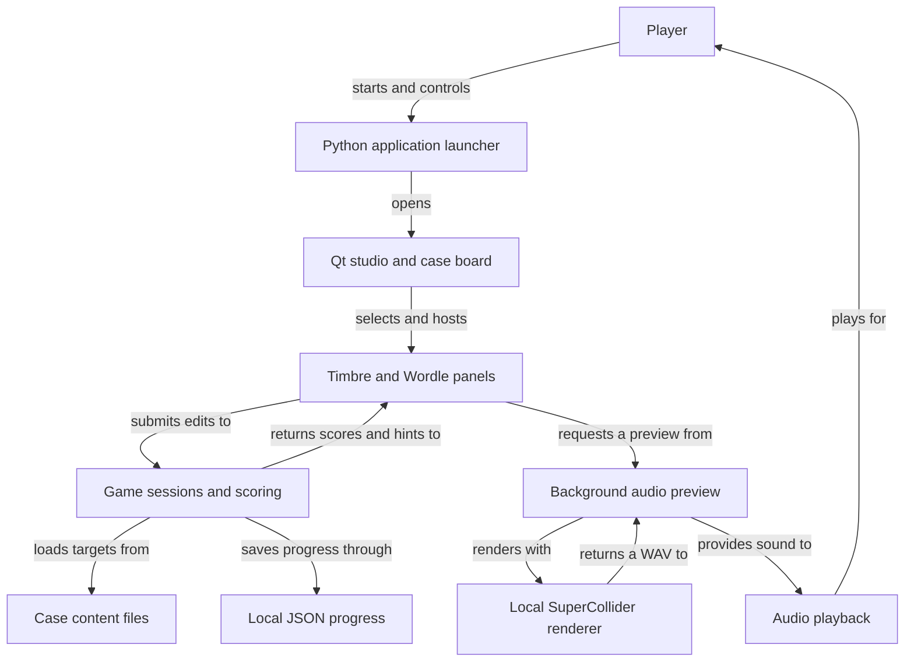
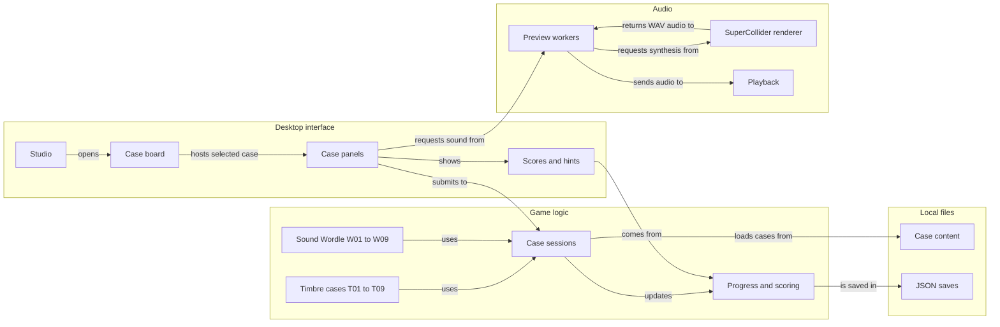

# Sound Detective Architecture Diagram

## Application Architecture

The desktop app guides a player from case selection through sound editing and submission. Game sessions own challenge rules and progress; preview workers render audio through the local SuperCollider tools; saves stay on the player's computer.

### Technology Stack Summary

| Area | Technology | Role |
| --- | --- | --- |
| Application | Python 3.11 | Game logic and desktop application |
| User interface | PySide6 6.8.3 | Qt windows, controls, and audio playback |
| Audio rendering | SuperCollider (`sclang`, `scsynth`) | Synthesizes the game's sounds locally |
| Audio processing | NumPy, SciPy, librosa, SoundFile | Sound comparison, analysis, and WAV handling |
| Progress storage | JSON files | Stores local case progress and preferences |

## Data Architecture

Case definitions are read from the project's content files. A game session evaluates submissions and produces scores, hints, and progress. Progress and preferences are saved as JSON in the local `userdata` folder; audio previews use temporary runtime files and can be recreated.

## Key Decisions

- Sound synthesis runs locally through SuperCollider; the game does not require a remote audio service.
- Preview rendering runs in the background so the interface can remain responsive and can discard results from replaced requests.
- Case content, game rules, audio rendering, and saved player progress are kept in separate parts of the project.

## Component Relationships

### Component Inventory

| Component | Responsibility |
| --- | --- |
| Studio and case board | Presents the game and routes the player to a selected case |
| Timbre and Wordle panels | Let the player listen, edit sound parameters, preview, and submit |
| Game sessions | Apply each case's rules and track submissions |
| Progress and scoring | Produces feedback, hints, and saved progress |
| Preview workers | Render requested sounds without blocking the interface |
| SuperCollider renderer | Synthesizes audio locally |
| Local files | Provide case definitions and retain player progress |
